# IP Calendar Poster

一个用于制作 IP 年份月历海报的 Codex Skill，也支持城市地标水彩月历这一题材类别。

上传一张 IP 人物参考图并指定年月，即可制作指定月份。全年系列默认先做 1 月完整样张，也可以指定其他样张月、沿用已确认的版式，或直接制作全年。每月保留同一角色身份和独立的季节场景。

## 2027 年案例

### 案例一：红蝴蝶结女孩 IP

保留首版全年案例，包含季节场景、月份换装、水彩卡片与黑色小鸟伙伴。

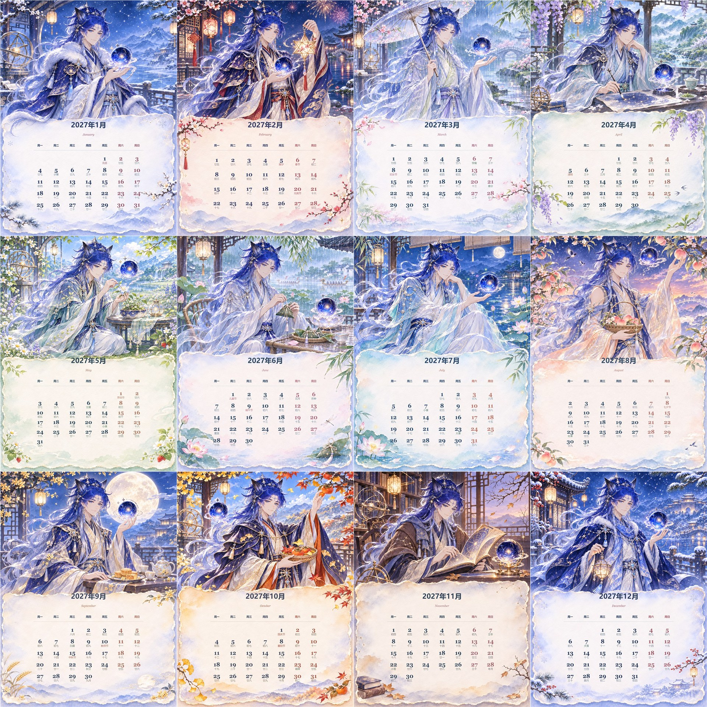

### 案例二：蓝发星辰兽耳 IP

全年正式交付包含 12 张独立单月成品。以下案例按每行 4 张展示；点击图片可以查看对应月份的独立预览。

<table>
  <tr>
    <td width="25%" align="center"><a href="assets/examples/tengger-2027/2027-01.jpg">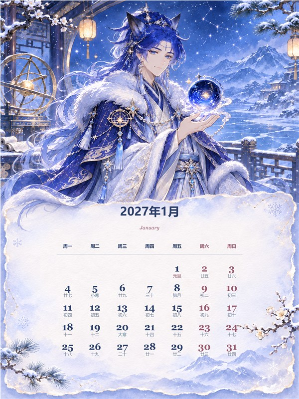</a><br><sub>2027 · 01</sub></td>
    <td width="25%" align="center"><a href="assets/examples/tengger-2027/2027-02.jpg">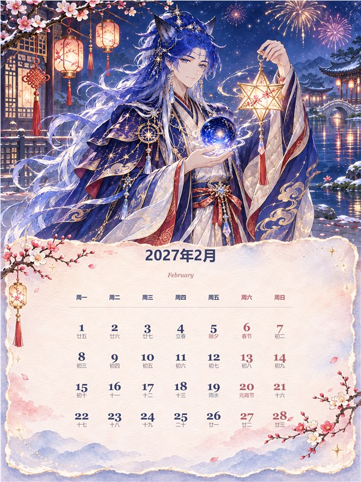</a><br><sub>2027 · 02</sub></td>
    <td width="25%" align="center"><a href="assets/examples/tengger-2027/2027-03.jpg">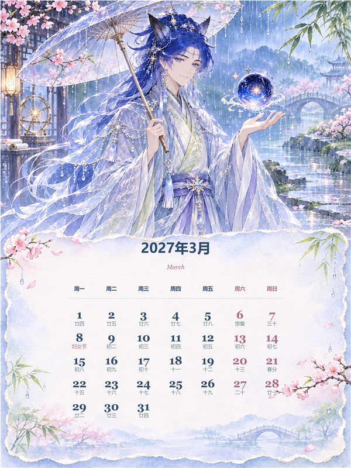</a><br><sub>2027 · 03</sub></td>
    <td width="25%" align="center"><a href="assets/examples/tengger-2027/2027-04.jpg">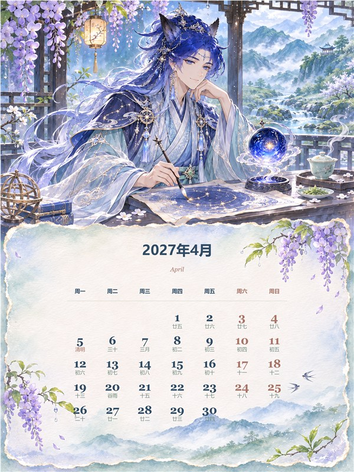</a><br><sub>2027 · 04</sub></td>
  </tr>
  <tr>
    <td width="25%" align="center"><a href="assets/examples/tengger-2027/2027-05.jpg">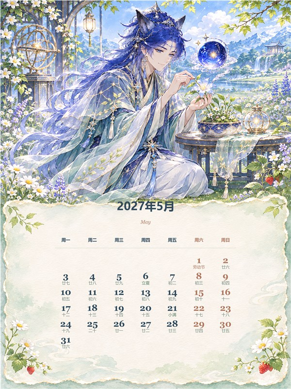</a><br><sub>2027 · 05</sub></td>
    <td width="25%" align="center"><a href="assets/examples/tengger-2027/2027-06.jpg">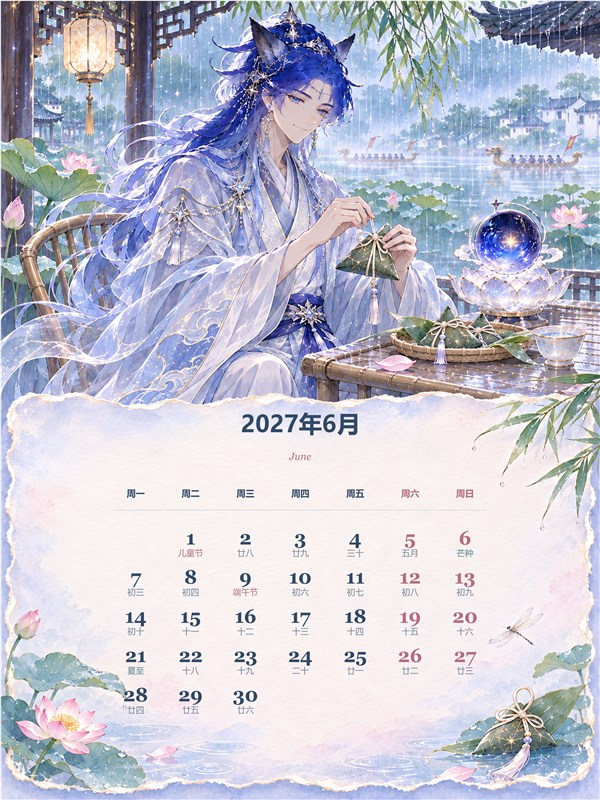</a><br><sub>2027 · 06</sub></td>
    <td width="25%" align="center"><a href="assets/examples/tengger-2027/2027-07.jpg">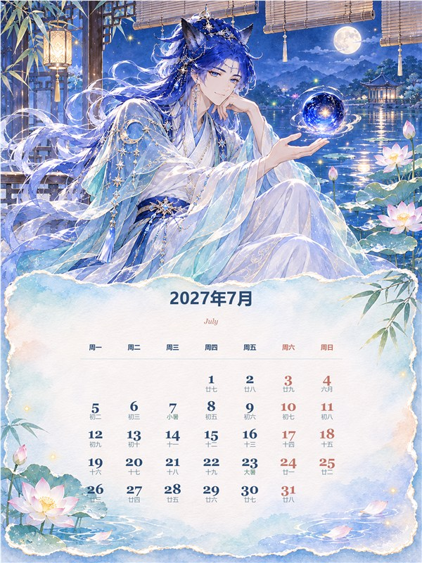</a><br><sub>2027 · 07</sub></td>
    <td width="25%" align="center"><a href="assets/examples/tengger-2027/2027-08.jpg">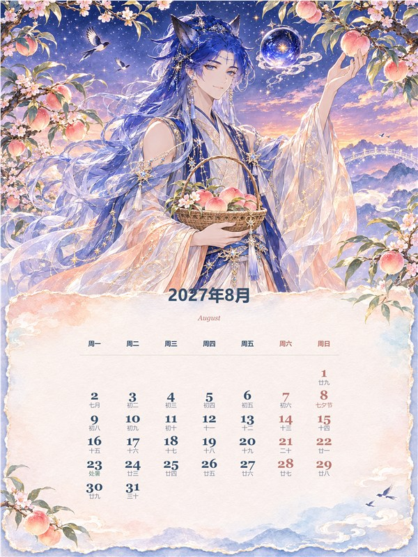</a><br><sub>2027 · 08</sub></td>
  </tr>
  <tr>
    <td width="25%" align="center"><a href="assets/examples/tengger-2027/2027-09.jpg">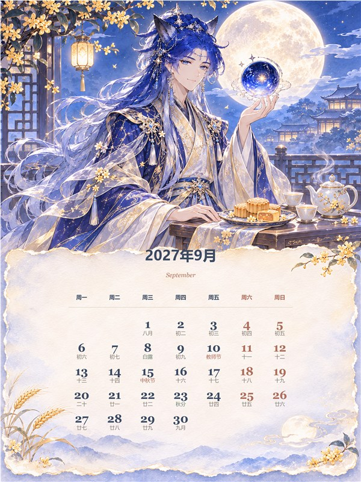</a><br><sub>2027 · 09</sub></td>
    <td width="25%" align="center"><a href="assets/examples/tengger-2027/2027-10.jpg">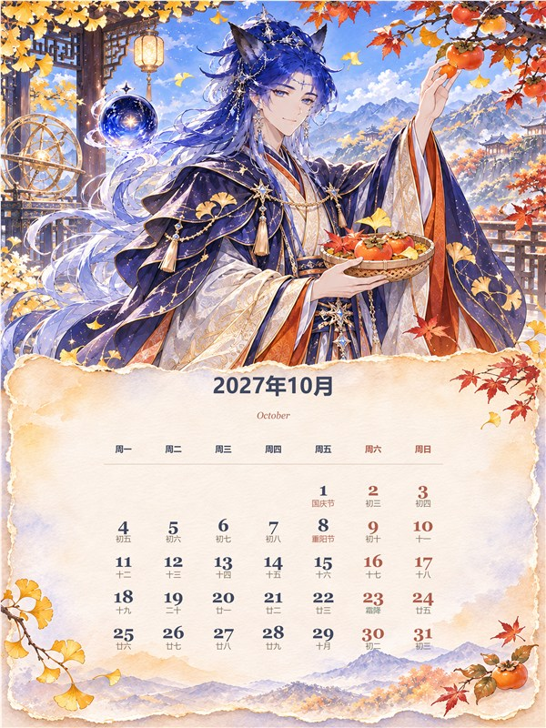</a><br><sub>2027 · 10</sub></td>
    <td width="25%" align="center"><a href="assets/examples/tengger-2027/2027-11.jpg">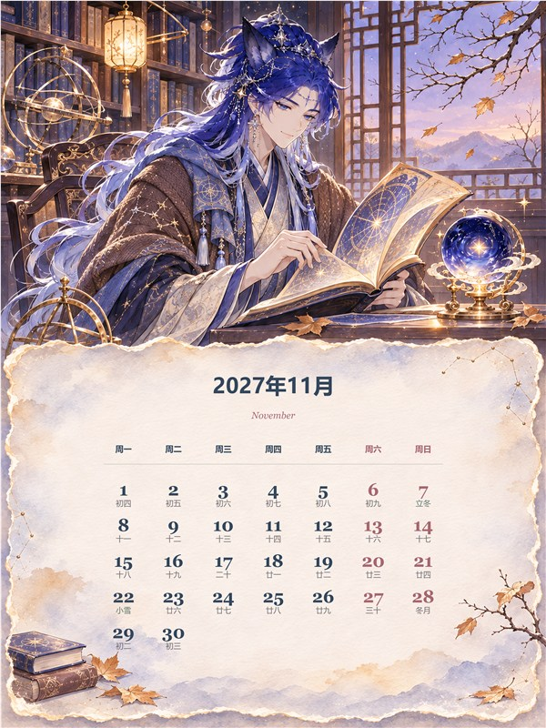</a><br><sub>2027 · 11</sub></td>
    <td width="25%" align="center"><a href="assets/examples/tengger-2027/2027-12.jpg">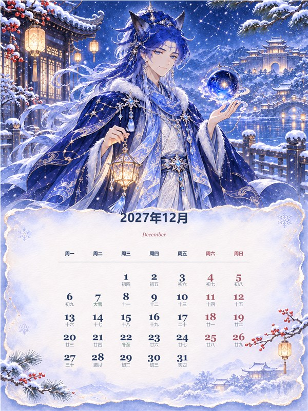</a><br><sub>2027 · 12</sub></td>
  </tr>
</table>

该案例的全年总览作为第 13 个辅助预览文件保留，但不会替代上面的 12 张单月成品。

[查看蓝发星辰兽耳 IP 的 2027 年全年总览](assets/examples/tengger-2027/full-year-preview.jpg)

### 案例三：深圳城市地标水彩月历

以深圳 12 处不同的现今景点为主题，每月一张完整月历。上半幅画景点，下半幅以景物本身的花叶、水色、建筑色延伸出水彩纸面；地名位于画面交接处，日期保持清晰。下图按 1—12 月顺序合成一张全年总览，原有两个 IP 案例保持独立展示。

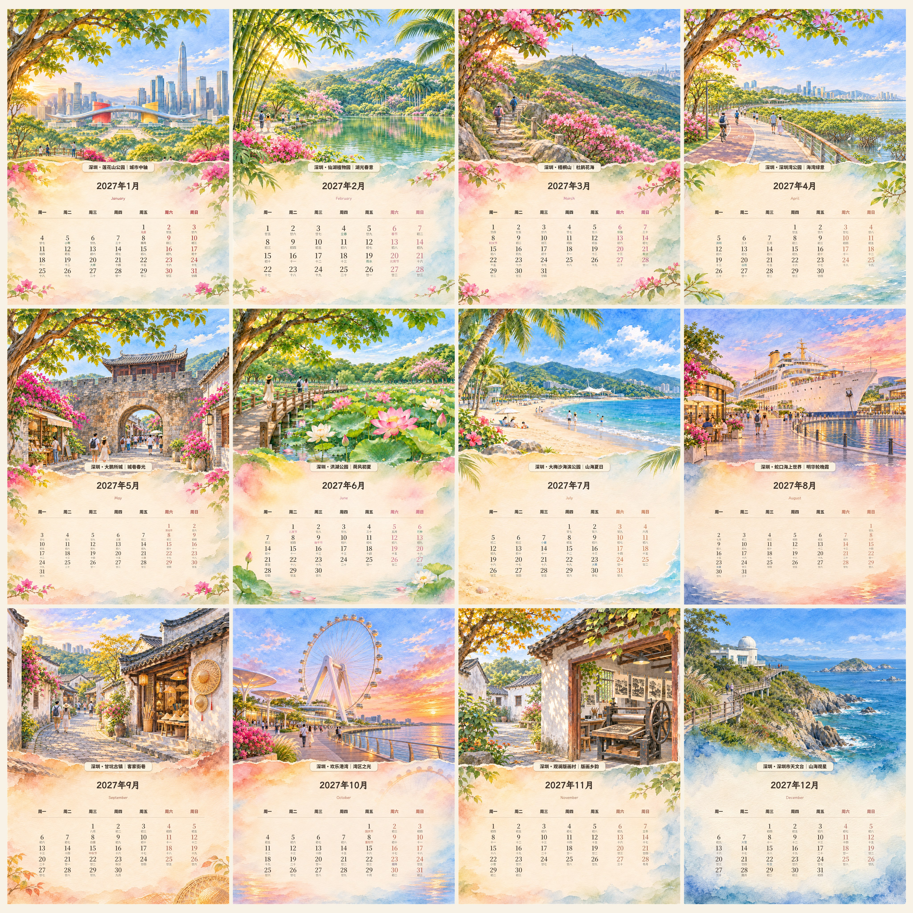

[单独查看深圳 2027 年全年总览大图](assets/examples/shenzhen-landmarks-2027-full-year-preview.jpg)

## 主要特点

- 需要确认样张时，先交付约定月份的完整月历，再完成其余月份。
- 使用上传图片锁定人物五官、发型、比例、材质与核心识别物。
- 服饰可以固定，也可以随月份和季节自动更新。
- 每个月自动设计不同场景、动作、植物、道具和色彩氛围。
- 下半部分固定使用清透、柔和的水彩卡片样式。
- 公历、农历、节气和重要节日先建立结构化数据，再程序化排版。
- 空白底图只在内部处理。调用生图前先确认该调用支持不自动展示图片；排入完整日期并验收后才对外展示。
- 全年正式交付为 12 张独立月历卡，每张只包含一个月份；可在最后用这 12 张成品本地追加一张全年总览，不额外调用图像生成。
- 星期采用周一至周日七列结构，周末与重要日期使用协调的强调色。
- 默认采用「温柔手写」版式，加粗霞鹜文楷年月，星期统一放大并使用思源黑体 Heavy。
- 日期网格会读取每个月真实的 4、5 或 6 行结构，自动调整周间距，不机械套用固定行高。
- 在 3072×4096 成图中，公历数字与农历、节气或节日文字默认保留 20px 可见间距。

## 安装

### 使用 Codex Skill Installer

```powershell
python -X utf8 "$env:USERPROFILE\.codex\skills\.system\skill-installer\scripts\install-skill-from-github.py" `
  --repo dorlarosendo434-hub/ip-calendar-poster `
  --path . `
  --name ip-calendar-poster
```

安装后重新打开 Codex，或在下一轮对话中显式调用 `$ip-calendar-poster`。

### 手动安装

```powershell
git clone https://github.com/dorlarosendo434-hub/ip-calendar-poster.git
Copy-Item -Recurse -Force `
  ".\ip-calendar-poster" `
  "$env:USERPROFILE\.codex\skills\ip-calendar-poster"
```

程序化日历排版脚本依赖 Python 与 Pillow：

```powershell
python -m pip install pillow
```

排版需要四个开源字体文件，下载入口和命令见 [温柔手写排版规范](references/calendar-fonts.md)。

## 使用示例

### 全年月历

```text
使用 $ip-calendar-poster，根据我上传的 IP 人物参考图，
先做 2027 年 1 月完整样张给我确认，再继续完成全年 12 张。服饰随季节更新。
```

## 推荐生产流程

1. 读取原始 IP 图，记录不可漂移的身份锚点。
2. 确认年份以及固定穿搭或随月份换装。
3. 按请求选定月份。需要样张时，先核验样张月日期，再按「温柔手写」版式制作完整样张。
4. 需要用户确认时先展示样张。全年项目的确认版计入最终的 12 张。
5. 沿用确定的版式、字体与水彩卡片样式，逐月核验并制作本次要求的其余月份。
6. 每个月从合适的内部底图开始，排入日期后检验成品，再进入下个月。
7. 按月逐一展示并交付 12 张可独立下载的完整图片。ZIP 和全年总览是补充入口。

## 动态日期排版

日历不是把所有月份强行压进相同模板：

- 4 行月份使用更舒展的周间距。
- 5 行月份保持均衡的纵向节奏。
- 6 行月份适度压缩周间距和必要字号，但不删除日期或农历信息。
- 公历数字与辅助文字保持稳定的组内层级。
- 最后一行与水彩边缘装饰之间保留安全距离，同时避免底部出现大块无效空白。

## 项目结构

```text
ip-calendar-poster/
├── SKILL.md
├── LICENSE.md
├── README.md
├── agents/
│   └── openai.yaml
├── assets/
│   ├── contact/
│   └── examples/
├── references/
│   ├── annual-series-system.md
│   ├── calendar-fonts.md
│   └── monthly-master-prompt-v4-1.md
└── scripts/
    └── render_calendar_card.py
```

## 使用许可

本项目采用自定义的个人非商业使用许可，不是允许任意商业使用的开源许可证。

- 个人学习、研究、非营利创作和个人非商业使用免费。
- 免费分享或修改时必须保留原作者、许可说明和修改记录。
- 商业项目、品牌宣传、客户交付、付费代做、商品销售、付费模板、课程交付、SaaS、订阅或其他营利用途，均需提前取得书面商业授权。
- 仓库公开、Fork、Issue、Pull Request 或未回复，不代表获得商业授权。

完整条款见 [LICENSE.md](LICENSE.md)。

使用者需要自行确认上传参考图、角色 IP、字体、商标和其他第三方素材的合法使用权限。

## 联系与商业授权

个人使用问题、AI 创作交流或商业授权，请通过下方微信联系。添加微信时请备注 **「AI交流」**；商业授权请备注 **「月历Skill授权」**。

<table>
  <tr>
    <td width="50%" align="center"><strong>添加微信</strong><br><sub>交流与商业授权</sub><br></td>
    <td width="50%" align="center"><strong>关注公众号</strong><br><sub>获取 AI 创作与 Skill 实操分享</sub><br></td>
  </tr>
</table>

## 免责声明

本项目按现状提供，不承诺适用于特定用途。许可声明用于明确作者的授权条件，不构成针对具体司法辖区或纠纷的法律意见。
