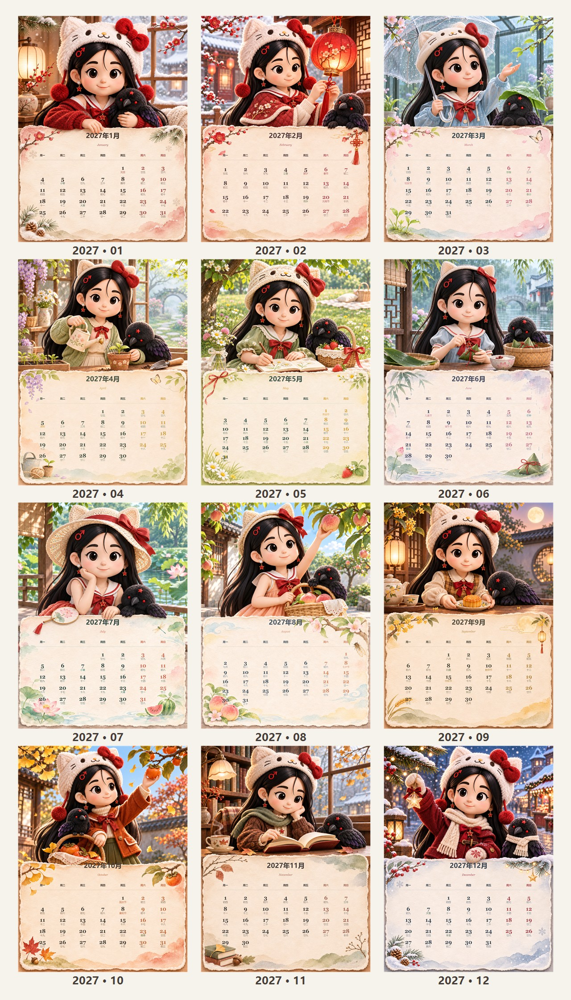

# IP Calendar Poster

一个用于制作 IP 年份月历海报的 Codex Skill。

上传一张 IP 人物参考图并指定年份后，它可以先建立准确的公历、农历、节气和重要节日数据，再生成一套具有统一角色身份、四季场景、月份换装与水彩卡片语言的 12 张月历海报。



## 主要特点

- 支持单月海报和全年 12 张系列月历。
- 使用上传图片锁定人物五官、发型、比例、材质与核心识别物。
- 服饰可以固定，也可以随月份和季节自动更新。
- 每个月自动设计不同场景、动作、植物、道具和色彩氛围。
- 下半部分固定使用清透、柔和的水彩卡片样式。
- 公历、农历、节气和重要节日先建立结构化数据，再程序化排版。
- 星期采用周一至周日七列结构，周末与重要日期使用协调的强调色。
- 日期网格会读取每个月真实的 4、5 或 6 行结构，自动调整周间距，不机械套用固定行高。
- 在 3072×4096 成图中，公历数字与农历、节气或节日文字默认保留 20px 可见间距。

## 安装

### 使用 Codex Skill Installer

```powershell
python -X utf8 "$env:USERPROFILE\.codex\skills\.system\skill-installer\scripts\install-skill-from-github.py" `
  --repo dorlarosendo434-hub/ip-calendar-poster `
  --path . `
  --name ip-calendar-poster
```

安装后重新打开 Codex，或在下一轮对话中显式调用 `$ip-calendar-poster`。

### 手动安装

```powershell
git clone https://github.com/dorlarosendo434-hub/ip-calendar-poster.git
Copy-Item -Recurse -Force `
  ".\ip-calendar-poster" `
  "$env:USERPROFILE\.codex\skills\ip-calendar-poster"
```

程序化日历排版脚本依赖 Python 与 Pillow：

```powershell
python -m pip install pillow
```

## 使用示例

### 全年月历

```text
使用 $ip-calendar-poster，根据我上传的 IP 人物参考图，
制作 2027 年全年 12 张月历海报，服饰随月份和季节更新。
```

### 单月海报

```text
使用 $ip-calendar-poster，为我上传的 IP 生成 2027 年 7 月月历海报，
保留原穿搭，直接输出 3:4 成图。
```

## 推荐生产流程

1. 读取原始 IP 图，记录不可漂移的身份锚点。
2. 确认年份以及固定穿搭或随月份换装。
3. 预先建立并核验全年日期数据。
4. 先测试 1 月冬季视觉，再测试 7 月夏季视觉。
5. 锁定人物身份、水彩卡片、字体层级和版式比例。
6. 逐月生成、逐张验收，最后进行全年一致性检查。

## 动态日期排版

日历不是把所有月份强行压进相同模板：

- 4 行月份使用更舒展的周间距。
- 5 行月份保持均衡的纵向节奏。
- 6 行月份适度压缩周间距和必要字号，但不删除日期或农历信息。
- 公历数字与辅助文字保持稳定的组内层级。
- 最后一行与水彩边缘装饰之间保留安全距离，同时避免底部出现大块无效空白。

## 项目结构

```text
ip-calendar-poster/
├── SKILL.md
├── LICENSE.md
├── README.md
├── agents/
│   └── openai.yaml
├── assets/
│   ├── contact/
│   └── examples/
├── references/
│   ├── annual-series-system.md
│   └── monthly-master-prompt-v4-1.md
└── scripts/
    └── render_calendar_card.py
```

## 使用许可

本项目采用自定义的个人非商业使用许可，不是允许任意商业使用的开源许可证。

- 个人学习、研究、非营利创作和个人非商业使用免费。
- 免费分享或修改时必须保留原作者、许可说明和修改记录。
- 商业项目、品牌宣传、客户交付、付费代做、商品销售、付费模板、课程交付、SaaS、订阅或其他营利用途，均需提前取得书面商业授权。
- 仓库公开、Fork、Issue、Pull Request 或未回复，不代表获得商业授权。

完整条款见 [LICENSE.md](LICENSE.md)。

使用者需要自行确认上传参考图、角色 IP、字体、商标和其他第三方素材的合法使用权限。

## 联系与商业授权

个人使用问题、AI 创作交流或商业授权，请通过下方微信联系。添加微信时请备注 **「AI交流」**；商业授权请备注 **「月历Skill授权」**。

<table>
  <tr>
    <td width="50%" align="center"><strong>添加微信</strong><br><sub>交流与商业授权</sub><br></td>
    <td width="50%" align="center"><strong>关注公众号</strong><br><sub>获取 AI 创作与 Skill 实操分享</sub><br></td>
  </tr>
</table>

## 免责声明

本项目按现状提供，不承诺适用于特定用途。许可声明用于明确作者的授权条件，不构成针对具体司法辖区或纠纷的法律意见。
